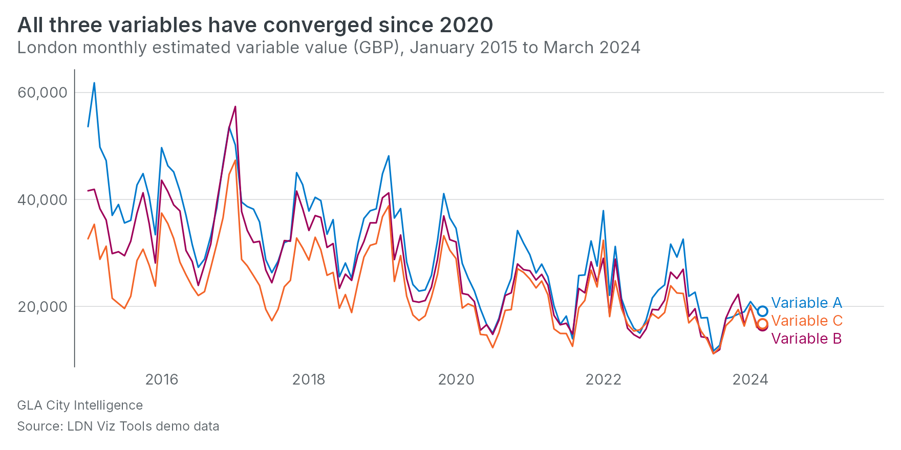

# gglaplot2 

Charts in the Greater London Authority’s house style, for ggplot2. The
successor to
[gglaplot](https://github.com/Greater-London-Authority/gglaplot).

The design tokens, the typeface and the chart conventions are the City
Intelligence Unit visualisation team’s, taken from their
[ldn-viz-tools](https://github.com/Greater-London-Authority/ldn-viz-tools)
package unchanged: the same tokens the Rhino dashboard template vendors,
so a static chart made here, a live chart on a dashboard and a chart on
one of the team’s sites read as one system. This package is the way
those decisions reach anyone plotting in R.

## Install

``` r
# install.packages("pak")
pak::pak("Greater-London-Authority/gglaplot2@main")
```

That installs `main`, which is always a version that passed the checks.
It needs ggplot2 4.0 or later. Keep the `@main`: without it you get
`dev`, the working branch. remotes and devtools do the same job:

``` r
remotes::install_github("Greater-London-Authority/gglaplot2@main")
devtools::install_github("Greater-London-Authority/gglaplot2@main")
```

On a GLA laptop the install can stop at the download with a connection
or certificate error, because R’s default download method does not go
through the corporate proxy. Tell R to use Windows’ own networking, then
install with remotes or devtools; pak fetches with its own client and
does not read that option:

``` r
options(download.file.method = "wininet")
remotes::install_github("Greater-London-Authority/gglaplot2@main")
```

Put the `options()` line in your `.Rprofile` and it holds for every
session.

## Use

``` r
library(ggplot2)
library(gglaplot2)

ggplot(gla_monthly, aes(month, value, colour = series)) +
  geom_gla_line() +
  geom_gla_endpoint() +
  geom_gla_endlabel(aes(label = series)) +
  scale_x_date(expand = expansion(mult = c(0.02, 0.18))) +
  scale_y_continuous(breaks = gla_breaks(), labels = scales::label_comma()) +
  scale_colour_gla() +
  gla_labs(
    title = "All three variables have converged since 2020",
    subtitle = "London monthly estimated variable value (GBP), January 2015 to March 2024",
    source = "LDN Viz Tools demo data", byline = "GLA City Intelligence", x = NULL
  ) +
  theme_gla(legend = "none")
```



- `theme_gla()`: the non-data ink from the `chart-*` tokens and the type
  from the design system’s chart roles; with ggplot2 4 the geom defaults
  too. `gla_mode("dark")` for an inverse surface, `theme_gla_map()` for
  a map.
- `geom_gla_line()`, `geom_gla_dot()`, `geom_gla_marker()`,
  `geom_gla_col()`, `geom_gla_area()`, `geom_gla_endlabel()`,
  `gla_zero_line()`, `gla_reference_line()`, `annotate_gla_range()`,
  `geom_gla_sf()`: the marks the web charts draw, reading their colour
  from the theme.
- `scale_colour_gla()`, `scale_fill_gla()` and the continuous variants:
  the palettes as scales. The default reads the series names the way the
  web charts do, so London against a comparator is primary against
  context grey.
- `gla_labs()`: title, subtitle, byline, source and note.
  `gla_describe()` writes a text alternative from the plot.
- `gla_save()`: the web charts’ 880 by 440, doubled.
- `gla_token()`, `gla_pal()`, `gla_tokens`, `gla_brand`: the tokens
  themselves.

The site at <https://greater-london-authority.github.io/gglaplot2/> has
a page per chart family with the code, and the foundations behind them.

## Typeface

Inter is bundled and registered with systemfonts when the package loads,
so ragg, svglite, knitr and pkgdown draw it on any machine. The base
graphics devices only know installed fonts and fall back to the device’s
sans; see `?gla_font`.

## Refreshing the tokens

The tokens are the visualisation team’s `@ldn-viz/themes` package on
npm, vendored under `inst/tokens/` with the release recorded in
`VERSION` (`gla_token_version()` reads it). To move to a new release:

``` r
source("data-raw/refresh-tokens.R")   # or: Rscript data-raw/refresh-tokens.R 9.3.0
devtools::document()
devtools::test()
```

It fetches the release, copies the token files in unchanged, rebuilds
`gla_tokens` and `gla_brand`, the gglaplot colour lists and the site
styling, and prints every token that was added, removed or changed. It
stops, naming the token, if the release has lost or renamed one this
package reads, so a rename upstream is a build failure here and not a
missing colour on a chart. The test suite checks the data against the
vendored files, so a refresh that was not regenerated fails too. Do the
Rhino dashboard template from the same release.

## Contributing

Development happens on feature branches off `dev`, merged by pull
request. Every pull request runs the linter, a check that `man/`,
`NAMESPACE` and the token data are up to date, `R CMD check` with the
tests on Ubuntu, macOS and Windows, on the current and previous R
releases and R devel, and on the oldest ggplot2 the package claims to
support, a coverage run with covr that fails below 90%, and a build of
the site. Every push to `dev` runs the same set and a green run
fast-forwards `main`, so `main` is always a version that passed
everywhere; a push to `main` publishes the site. A weekly job compares
the latest `@ldn-viz/themes` release on npm against the vendored one
and, when it is behind, runs the refresh and opens the pull request with
the token changes in the body; it fails instead if the release has
dropped a token the package reads. Releases are tagged on `main` and
recorded in `NEWS.md`.

Do not push to `main` directly. If it ever gets ahead of `dev` the
promotion job refuses to force it and says so; merge `main` into `dev`
and push again.

Before opening a pull request:

``` r
lintr::lint_package()
devtools::document()
devtools::test()
devtools::check()
```

The visual snapshots under `tests/testthat/_snaps/` are drawn with the
bundled Inter through svglite, so they match across machines; after a
change that moves pixels on purpose, run `testthat::snapshot_review()`.

## Releasing

A release is a pull request to `dev` that sets a release version in
`DESCRIPTION` and heads `NEWS.md` with it, `# gglaplot2 0.2.0` over the
notes written as the work landed. When it promotes, the promotion tags
`main` as `v0.2.0`, makes the GitHub release with that section of
`NEWS.md` as its notes, and opens the pull request that moves `dev` on
to `0.2.0.9000`. A release can then be installed by its tag:

``` r
remotes::install_github("Greater-London-Authority/gglaplot2@v0.2.0")
```

Features make a minor release, fixes alone a patch one. `v0.1.0` is the
first full build.

## From gglaplot

Everything gglaplot exported is here under its old name, with the old
arguments translated and the chart drawn in the current style, so a
script written against it runs after changing `library(gglaplot)` to
`library(gglaplot2)`. Each old name says once a session what it is now.
The Migrating from gglaplot page on the site lists them side by side.

The old names stay for the whole 0.x series. The last 0.x release turns
the once-a-session note into a warning on every call, and 1.0 removes
them, so an old script has a release's notice to move.
